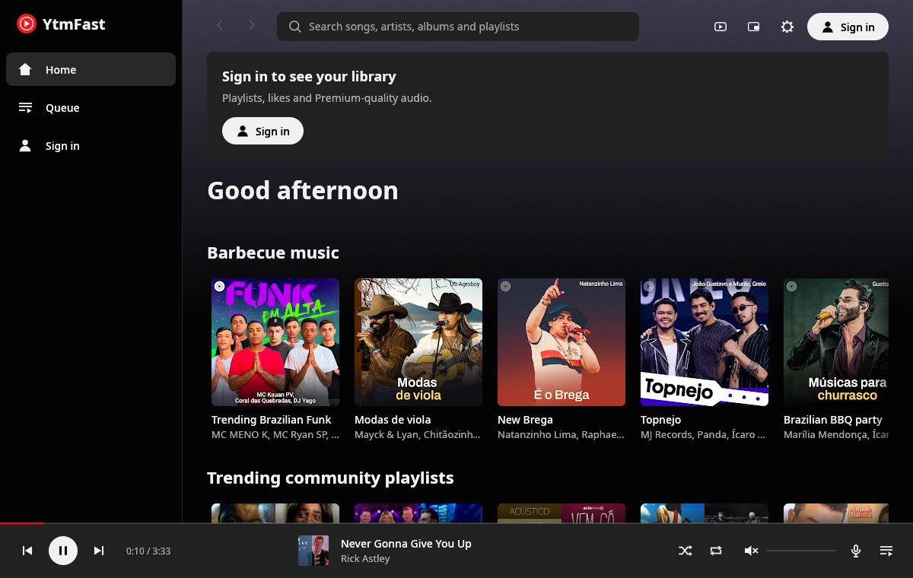
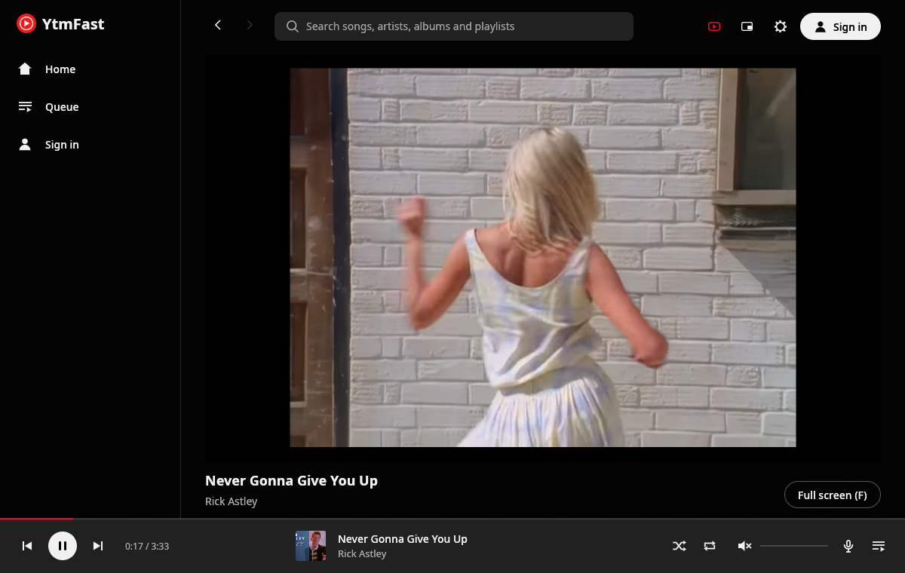
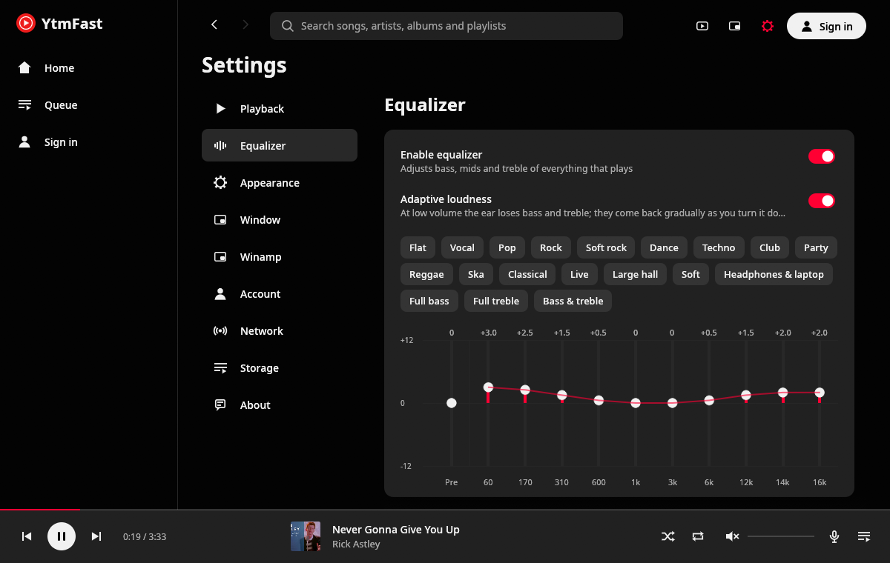
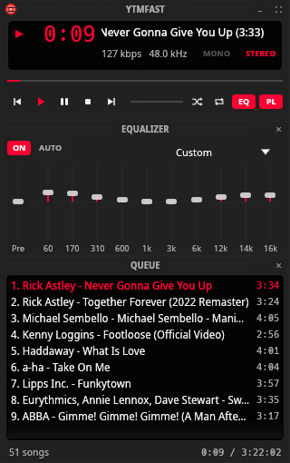
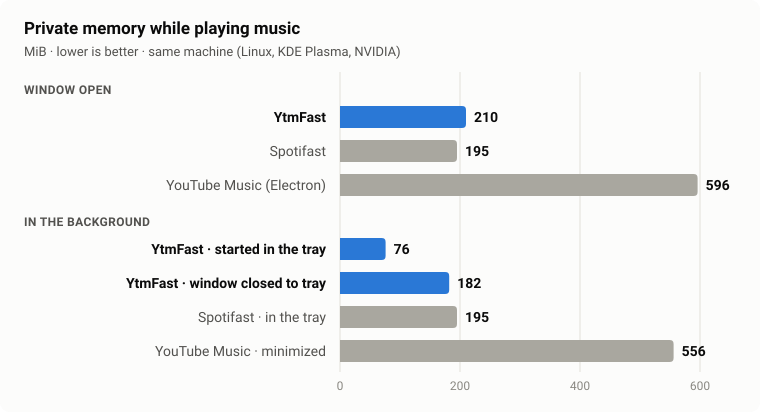

<p align="center">
  
</p>

<h1 align="center">YtmFast</h1>

<p align="center"><strong>YouTube Music, native and fast.</strong><br>A lightweight YouTube Music client for Linux, written in Rust (Windows and macOS on the way).</p>

<p align="center"><b>English</b> · <a href="README.pt-BR.md">Português (Brasil)</a></p>

<p align="center">
  
</p>

YtmFast plays YouTube Music without a browser and without Electron. The interface is drawn with
[egui](https://github.com/emilk/egui), audio goes through [mpv](https://mpv.io), and the data
comes from YouTube Music's own API through [rustypipe](https://codeberg.org/ThetaDev/rustypipe).
The idea came from [Spotifast](https://github.com/crmne/spotifast): be fast, use little, and feel
like the real app, with a few extras.

## Features

- **Your YouTube Music account**: personalized home ("Listen again", new releases, mixes),
  library, liked songs, playlists (create, delete, reorder), artists, albums and search.
- **Sign in without a password**: it reads the session from your default browser. Your password
  never goes through the app. If YouTube silently drops the session, it's renewed on its own.
- **Synced lyrics** that follow the song, in a side panel or full screen; click a line to jump
  there. Optional **word-by-word (karaoke)** style, and a ±0.5 s nudge when a song's lyrics run
  early or late.
- **"Most replayed" ridge** over the progress bar on hover, with a jump to the part everyone
  replays.
- **Music videos** play inside the app without interrupting the audio, only while the tab is
  open.
- **10-band equalizer** with 19 Winamp presets, an exact curve, and **adaptive loudness** (brings
  back bass and treble at low volume).
- **Crossfade** between songs (2 to 12 s), with a matching animation in the player bar.
- **Compact player** in the Winamp spirit (display, analyser, equalizer and queue) in three styles
  (modern, classic, LCD) that follow your theme, or classic `.wsz` skins: the original one
  recolored with your theme, a few to download from Webamp's collection, or your own.
- **Desktop integration**: tray icon (middle-click to pause), MPRIS (taskbar controls, media keys,
  `playerctl`), terminal commands and a single instance.
- **Themes** (Catppuccin, Dracula, Gruvbox, Nord, Tokyo Night, Rosé Pine, Kanagawa, Everforest, Solarized, One Dark, or your own), with five switch animations that take turns (sweep, curtain, honeycomb, blinds, mosaic).
- **Start with the computer**, hidden in the tray.
- **Your summary**: top artists and songs of the last 30 days, from the local history.
- **Extras**: playback speed (0.75× to 2×), "Copy link" on songs, albums, playlists and artists,
  a notification when the song changes with the window hidden, scrobbling to
  [ListenBrainz](https://listenbrainz.org).
- **English and Brazilian Portuguese**: follows your system language, or pick one in settings.

<p align="center">
  
  
</p>
<p align="center">
  
</p>

## Performance

<p align="center">
  
</p>

Spotifast is here as a target, not a rival: it's a different app for a different service, and
YtmFast set out to be as light as it is. The Electron app shows what a typical desktop client
costs.

| Playing music | YtmFast | Spotifast | YouTube Music (Electron) |
|---|---|---|---|
| Memory, window open | 210 MiB | 195 MiB | 596 MiB |
| Memory, in the background | **76 MiB** (started in the tray) · 182 MiB (window closed) | 195 MiB | 556 MiB (minimized) |
| CPU, window open | **0.6%** | 5.2% | 19.5% |
| CPU, in the background | **0.4–0.6%** | 0.9% | 4.4% |

Idle, YtmFast stays at **0%** CPU, with or without a window. Skipping to the next song takes
**~0.2 s** until sound.

**How it was measured.**
- All three apps ran on the same machine (Linux, KDE Plasma on Wayland, GeForce GTX 1650), one at a
  time, playing a song for 40 s before each reading.
- Memory is private memory (`Private_Clean + Private_Dirty` from `/proc/<pid>/smaps_rollup`),
  summed over all of the app's processes. YouTube Music is built on Electron and runs several.
- CPU is a 30-second average.
- YtmFast ran in a signed-out session; Spotifast and YouTube Music ran signed in. With your library
  loaded, YtmFast goes up a few MiB.
- YouTube Music was minimized, since it isn't set to stay in the tray in the setup tested.

**Where the lightness comes from.**
- With no window there's no interface: in the tray only the player keeps running.
- Started in the tray (as when it starts with the computer), the GPU driver isn't even loaded. Once a
  window has opened, the NVIDIA driver keeps part of its memory until the app quits.
- Artwork has a memory budget and is loaded by a fixed pool of 4 threads.
- On NVIDIA-only machines, Mesa (and LLVM) aren't loaded for nothing.
- mpv reads ahead one minute instead of the whole song, and runs without its unused built-in
  scripts.
- Nothing redraws without a reason: idle, the CPU stays at zero.
- The next song's stream link is resolved while the current one plays.

## Installation

Downloads are on the [releases page](https://github.com/clevim/YtmFast/releases).

| Distribution | How |
|---|---|
| **Debian 13+ / Ubuntu 25.04+** | `.deb`: `sudo apt install ./ytmfast_*.deb` |
| **Fedora 41+** | `.rpm`: `sudo dnf install ./ytmfast-*.rpm` |
| **Arch Linux** | `makepkg -si` with the PKGBUILD from the release's `…-recipes.tar.gz` (below). AUR packages (`yay -S ytmfast`) coming soon. |
| **Other distributions** | the `.tar.gz`, or build it (below). |

**Requirements:** Wayland or X11, [mpv](https://mpv.io)'s `libmpv` 0.38 or newer,
[yt-dlp](https://github.com/yt-dlp/yt-dlp) kept up to date (old versions stop working when
YouTube changes), and optionally PipeWire (it feeds the compact player's analyser).

### Arch Linux

Until the packages are on the AUR (new account registration there is paused for now), the same
recipes install with `makepkg`. Each release attaches them, filled in for that version:

```sh
mkdir ytmfast && cd ytmfast
curl -LO https://github.com/clevim/YtmFast/releases/latest/download/ytmfast-v0.1.0-recipes.tar.gz
tar xzf ytmfast-*-recipes.tar.gz
cd arch/ytmfast-bin   # the release binary; or arch/ytmfast to build from source
makepkg -si
```

Replace `v0.1.0` with the release's version. Pacman installs the dependencies (mpv, yt-dlp)
and the app updates like any package when you repeat this with a newer release.

### Building

Rust 1.88 or newer and libmpv (0.38+):

```sh
cargo install --path . --locked
```

To show up in the application menu, with an icon:

```sh
install -Dm644 packaging/linux/ytmfast.desktop ~/.local/share/applications/ytmfast.desktop
install -Dm644 packaging/linux/ytmfast.svg ~/.local/share/icons/hicolor/scalable/apps/ytmfast.svg
```

If `~/.cargo/bin` isn't in your desktop's `PATH`, replace `Exec=ytmfast` in the `.desktop` file
with the full path.

### Windows and macOS (to do)

Not released yet. The code already builds for both; what's left:

- [ ] Packages: Windows installer and portable zip, macOS DMGs (Apple silicon and Intel), with
      mpv and yt-dlp inside, plus their release and CI jobs.
- [ ] A first real run on each system (tray, media keys, sign-in, autostart, notifications).
- [ ] The compact player's analyser: WASAPI loopback on Windows, a capture API on macOS.
- [ ] macOS signing and notarization (needs an Apple Developer account).
- [ ] A Homebrew cask.

## Usage

Open the app, click **Sign in** and pick the browser where you're already signed in to YouTube
Music.

From the terminal, commands control the running app:

```sh
ytmfast play-pause | play | pause | stop | next | previous
ytmfast seek 10          # forward (negative goes back)
ytmfast volume 60        # also: volume-up, volume-down, mute
ytmfast now-playing      # current track (--raw for JSON)
ytmfast play-uri "https://music.youtube.com/watch?v=dQw4w9WgXcQ"
ytmfast --tray           # start hidden in the tray
```

Or through MPRIS: `playerctl -p ytmfast play-pause`.

<details>
<summary>Keyboard shortcuts</summary>

| Key | Action |
|---|---|
| Space | Play / pause |
| Ctrl + ← / → | Previous / next track |
| ← / → | Back / forward 5 s (Shift: 10 s) |
| Ctrl + ↑ / ↓ | Volume |
| M | Mute |
| B | Like the current track |
| S / R | Shuffle / repeat |
| Q | Queue |
| L | Lyrics |
| Ctrl + F or / | Search |
| Ctrl + B | Show / hide the sidebar |
| Alt + ← / → | Back / forward between pages |
| Ctrl + H / Ctrl + L | Home / liked songs |
| Ctrl + Shift + A / B | Current track's artist / album |
| Ctrl + M | Compact player |
| Ctrl + Shift + K | Video |
| F | Full screen (in video) |
| Ctrl + , | Settings |
| ? or Ctrl + / | Shortcut list |
| Ctrl + Q | Quit |

</details>

## Privacy

- Signing in uses your browser's YouTube cookies, filtered to `youtube.com` only and stored in
  `~/.local/share/ytmfast`, readable by your user alone.
- yt-dlp gets a throwaway copy of them, never the original.
- No data goes anywhere other than YouTube itself, [LRCLIB](https://lrclib.net) for lyrics YouTube
  doesn't have and, only with word-by-word lyrics turned on, KuGou. Those two get only the song and
  artist names (and its length).
- With a ListenBrainz token, the songs you play (names, length, link) go to your ListenBrainz
  profile. The token is stored with the settings, readable by your user alone.

## Credits

- Inspired by [Spotifast](https://github.com/crmne/spotifast), by Carmine Paolino.
- The theme transition is adapted from `fastframe-theme`, by the same author (MIT).
- Built on [egui](https://github.com/emilk/egui), [mpv](https://mpv.io),
  [yt-dlp](https://github.com/yt-dlp/yt-dlp) and [rustypipe](https://codeberg.org/ThetaDev/rustypipe).
- The equalizer presets and the skin format come from Winamp 2, as documented by
  [Webamp](https://github.com/captbaritone/webamp).

## License

[MIT](LICENSE), like Spotifast. The part adapted from `fastframe-theme` keeps its original license
notice in the same file.

YtmFast is not affiliated with YouTube or Google.
