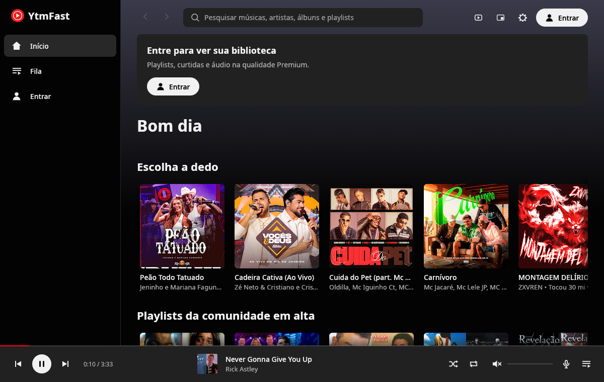
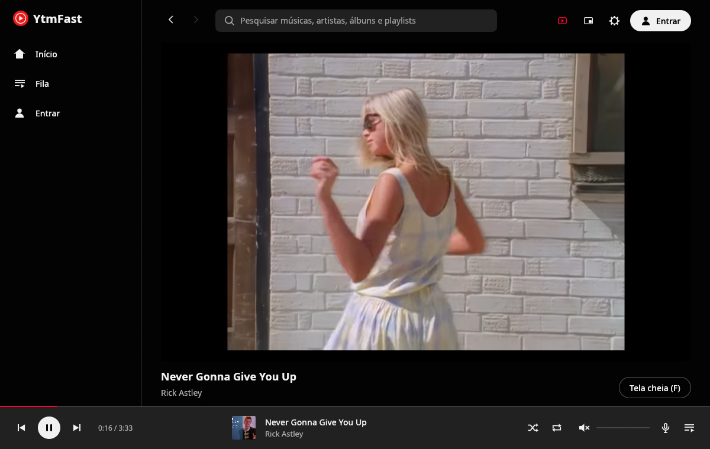
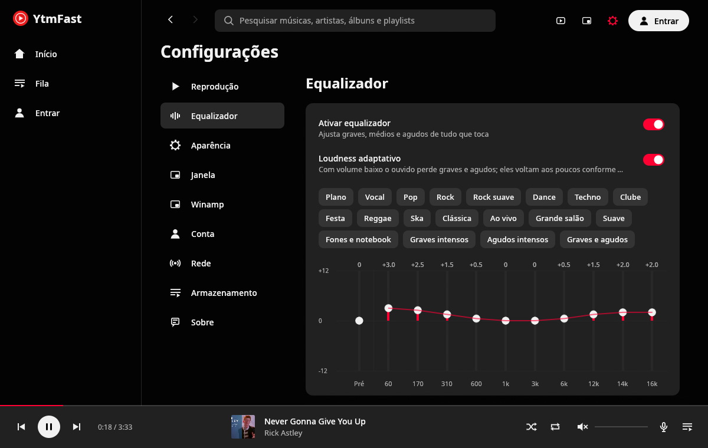
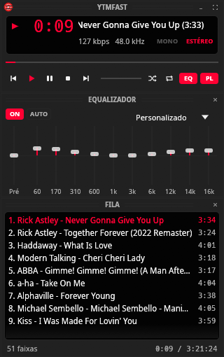
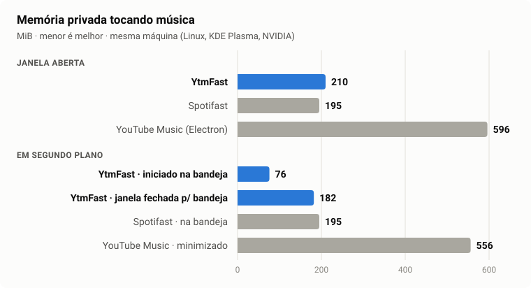

<p align="center">
  
</p>

<h1 align="center">YtmFast</h1>

<p align="center"><strong>YouTube Music, nativo e rápido.</strong><br>Cliente leve do YouTube Music para Linux, escrito em Rust (Windows e macOS a caminho).</p>

<p align="center"><a href="README.md">English</a> · <b>Português (Brasil)</b></p>

<p align="center">
  
</p>

O YtmFast toca o YouTube Music sem navegador e sem Electron. A interface é desenhada com
[egui](https://github.com/emilk/egui), o som sai pelo [mpv](https://mpv.io) e os dados vêm da
API interna do YouTube Music via [rustypipe](https://codeberg.org/ThetaDev/rustypipe). A ideia
veio do [Spotifast](https://github.com/crmne/spotifast): ser rápido, gastar pouco e parecer o
app original, com algumas coisas a mais.

## O que ele faz

- **Sua conta do YouTube Music**: início personalizado ("Ouvir de novo", lançamentos, mixes),
  biblioteca, músicas curtidas, playlists (criar, apagar, reordenar), artistas, álbuns e busca.
- **Login sem senha**: lê a sessão do navegador padrão do sistema. A senha nunca passa pelo app.
  Se o YouTube derrubar a sessão sem avisar, ela é renovada sozinha.
- **Letra sincronizada** acompanhando a música, em painel lateral ou tela cheia; clicar numa
  linha pula para aquele trecho. Estilo opcional **palavra por palavra (karaokê)**, e ajuste de
  ±0,5 s quando a letra de uma música vem adiantada ou atrasada.
- **Faixa "mais repetido"** sobre a barra de progresso ao passar o mouse, com atalho para o trecho
  que todo mundo repete.
- **Vídeo**: clipes tocam dentro do app sem interromper o áudio, só enquanto a aba está aberta.
- **Equalizador de 10 bandas** com 19 predefinições do Winamp, curva exata e **loudness
  adaptativo** (repõe graves e agudos quando o volume está baixo).
- **Transição suave entre músicas** (crossfade de 2 a 12 s), com animação na barra do player.
- **Player compacto** no estilo do Winamp (visor, analisador, equalizador e fila) em três estilos
  (moderno, clássico, LCD) que seguem o seu tema, ou skins `.wsz` clássicas: a original
  recolorida com o seu tema, algumas para baixar da coleção do Webamp, ou as suas.
- **Integração com o desktop**: bandeja (com clique do meio para pausar), MPRIS (controles da
  barra de tarefas, teclas de mídia, `playerctl`), comandos de terminal e instância única.
- **Temas** (Catppuccin, Dracula, Gruvbox, Nord, Tokyo Night, Rosé Pine, Kanagawa, Everforest, Solarized, One Dark, ou os seus), com cinco animações de troca que se revezam (varredura, cortina, colmeia, persianas, mosaico).
- **Iniciar com o computador**, escondido na bandeja.
- **Seu resumo**: artistas e músicas mais ouvidos nos últimos 30 dias, a partir do histórico local.
- **Extras**: velocidade de reprodução (0,75× a 2×), "Copiar link" em músicas, álbuns, playlists e
  artistas, aviso quando a música muda com a janela escondida, scrobble para o
  [ListenBrainz](https://listenbrainz.org).
- **Português e inglês**: segue o idioma do sistema, ou escolha nas configurações.

<p align="center">
  
  
</p>
<p align="center">
  
</p>

## Desempenho

<p align="center">
  
</p>

O Spotifast aparece aqui como meta, não como rival: é outro app, de outro serviço, e o YtmFast
nasceu com o objetivo de ser tão leve quanto ele. O app em Electron mostra quanto custa um cliente
de desktop comum.

| Tocando música | YtmFast | Spotifast | YouTube Music (Electron) |
|---|---|---|---|
| Memória, janela aberta | 210 MiB | 195 MiB | 596 MiB |
| Memória, em segundo plano | **76 MiB** (iniciado na bandeja) · 182 MiB (janela fechada) | 195 MiB | 556 MiB (minimizado) |
| CPU, janela aberta | **0,6%** | 5,2% | 19,5% |
| CPU, em segundo plano | **0,4–0,6%** | 0,9% | 4,4% |

Parado, o YtmFast fica em **0%** de CPU, com ou sem janela. Pular para a próxima música leva
**~0,2 s** até o som.

**Como foi medido.**
- Os três apps rodaram na mesma máquina (Linux, KDE Plasma no Wayland, GeForce GTX 1650), um de cada
  vez, tocando uma música por 40 s antes de cada medida.
- Memória é a memória privada (`Private_Clean + Private_Dirty` de `/proc/<pid>/smaps_rollup`),
  somada em todos os processos do app. O YouTube Music, feito em Electron, roda em vários.
- CPU é a média de 30 s.
- O YtmFast rodou numa sessão sem login. O Spotifast e o YouTube Music rodaram com as contas já
  conectadas. Com a sua biblioteca carregada, o YtmFast sobe alguns MiB.
- O YouTube Music foi minimizado porque, na configuração usada, ele não fica na bandeja.

**De onde vem a leveza.**
- Sem janela não há interface: na bandeja só o player continua rodando.
- Iniciado na bandeja (como no início junto com o computador), o driver de vídeo nem chega a
  carregar. Depois que uma janela abre, o driver da NVIDIA guarda parte da memória até o app fechar.
- Imagens têm teto de memória e são carregadas por um grupo fixo de 4 threads.
- Em máquinas só com NVIDIA, o Mesa (e o LLVM) não é carregado à toa.
- O mpv lê um minuto à frente em vez da música inteira, e roda sem os scripts embutidos que não usamos.
- Nada redesenha sem motivo: parado, a CPU fica em zero.
- O link da próxima música é resolvido enquanto a atual toca.

## Instalação

Os downloads estão na [página de releases](https://github.com/clevim/YtmFast/releases).

| Distribuição | Como |
|---|---|
| **Debian 13+ / Ubuntu 25.04+** | `.deb`: `sudo apt install ./ytmfast_*.deb` |
| **Fedora 41+** | `.rpm`: `sudo dnf install ./ytmfast-*.rpm` |
| **Arch Linux** | `makepkg -si` com o PKGBUILD do `…-recipes.tar.gz` do release (abaixo). Pacotes no AUR (`yay -S ytmfast`) em breve. |
| **Outras distribuições** | o `.tar.gz`, ou compile (abaixo). |

**Requisitos:** Wayland ou X11, a `libmpv` do [mpv](https://mpv.io) 0.38 ou mais nova, o
[yt-dlp](https://github.com/yt-dlp/yt-dlp) atualizado (versões velhas param de funcionar quando o
YouTube muda) e, opcional, o PipeWire (alimenta o analisador do player compacto).

### Arch Linux

Até os pacotes chegarem ao AUR (o cadastro de contas novas lá está pausado por enquanto), as mesmas
receitas instalam com o `makepkg`. Cada release traz elas preenchidas para aquela versão:

```sh
mkdir ytmfast && cd ytmfast
curl -LO https://github.com/clevim/YtmFast/releases/latest/download/ytmfast-v0.1.1-recipes.tar.gz
tar xzf ytmfast-*-recipes.tar.gz
cd arch/ytmfast-bin   # o binário do release; ou arch/ytmfast para compilar do código
makepkg -si
```

Troque `v0.1.1` pela versão do release. O pacman instala as dependências (mpv, yt-dlp), e o app
atualiza como qualquer pacote quando você repete isso com um release mais novo.

### Compilando

Rust 1.88 ou mais novo e a libmpv (0.38+):

```sh
cargo install --path . --locked
```

Para aparecer no menu de aplicativos, com ícone:

```sh
install -Dm644 packaging/linux/ytmfast.desktop ~/.local/share/applications/ytmfast.desktop
install -Dm644 packaging/linux/ytmfast.svg ~/.local/share/icons/hicolor/scalable/apps/ytmfast.svg
```

Se o `~/.cargo/bin` não estiver no `PATH` do seu desktop, troque o `Exec=ytmfast` do arquivo
`.desktop` pelo caminho completo.

### Windows e macOS (a fazer)

Ainda sem versão publicada. O código já compila para os dois; falta:

- [ ] Pacotes: instalador e zip portátil no Windows, DMGs no macOS (Apple silicon e Intel), com o
      mpv e o yt-dlp dentro, e os jobs de release e CI.
- [ ] Uma primeira execução real em cada sistema (bandeja, teclas de mídia, login, iniciar com o
      sistema, notificações).
- [ ] O analisador do player compacto: loopback WASAPI no Windows, uma API de captura no macOS.
- [ ] Assinatura e notarização no macOS (exige conta de desenvolvedor da Apple).
- [ ] Um cask do Homebrew.

## Uso

Abra o app, clique em **Entrar** e escolha o navegador onde você já está logado no YouTube
Music.

Pelo terminal, os comandos controlam o app que já está aberto:

```sh
ytmfast play-pause | play | pause | stop | next | previous
ytmfast seek 10          # avança (negativo volta)
ytmfast volume 60        # também: volume-up, volume-down, mute
ytmfast now-playing      # faixa atual (--raw para JSON)
ytmfast play-uri "https://music.youtube.com/watch?v=dQw4w9WgXcQ"
ytmfast --tray           # inicia escondido na bandeja
```

Ou via MPRIS: `playerctl -p ytmfast play-pause`.

<details>
<summary>Atalhos de teclado</summary>

| Tecla | Ação |
|---|---|
| Espaço | Tocar / pausar |
| Ctrl + ← / → | Faixa anterior / próxima |
| ← / → | Voltar / avançar 5 s (Shift: 10 s) |
| Ctrl + ↑ / ↓ | Volume |
| M | Mudo |
| B | Curtir a faixa atual |
| S / R | Aleatório / repetir |
| Q | Fila |
| L | Letra |
| Ctrl + F ou / | Buscar |
| Ctrl + B | Mostrar / esconder a barra lateral |
| Alt + ← / → | Voltar / avançar entre telas |
| Ctrl + H / Ctrl + L | Início / músicas curtidas |
| Ctrl + Shift + A / B | Artista / álbum da faixa atual |
| Ctrl + M | Player compacto |
| Ctrl + Shift + K | Vídeo |
| F | Tela cheia (no vídeo) |
| Ctrl + , | Configurações |
| ? ou Ctrl + / | Lista de atalhos |
| Ctrl + Q | Sair |

</details>

## Privacidade

- O login é feito com as cookies do YouTube do seu navegador, filtradas só para `youtube.com` e
  guardadas em `~/.local/share/ytmfast` com acesso apenas do seu usuário.
- O yt-dlp recebe uma cópia descartável delas, nunca o original.
- Nenhum dado vai para servidores além do próprio YouTube, do [LRCLIB](https://lrclib.net) para
  letras que o YouTube não tem e, só com a letra palavra por palavra ligada, da KuGou. Esses dois
  recebem só o nome da música, do artista e a duração.
- Com um token do ListenBrainz, as músicas que você ouve (nomes, duração, link) vão para o seu perfil
  lá. O token fica guardado com as configurações, com acesso apenas do seu usuário.

## Créditos

- Inspirado no [Spotifast](https://github.com/crmne/spotifast), de Carmine Paolino.
- A transição de tema é adaptada do `fastframe-theme`, do mesmo autor (MIT).
- Feito sobre [egui](https://github.com/emilk/egui), [mpv](https://mpv.io),
  [yt-dlp](https://github.com/yt-dlp/yt-dlp) e [rustypipe](https://codeberg.org/ThetaDev/rustypipe).
- As predefinições do equalizador e o formato de skins vêm do Winamp 2, como documentados pelo
  [Webamp](https://github.com/captbaritone/webamp).

## Licença

[MIT](LICENSE), como o Spotifast. O trecho adaptado do `fastframe-theme` mantém o aviso de
licença original no mesmo arquivo.

O YtmFast não tem relação com o YouTube nem com o Google.
